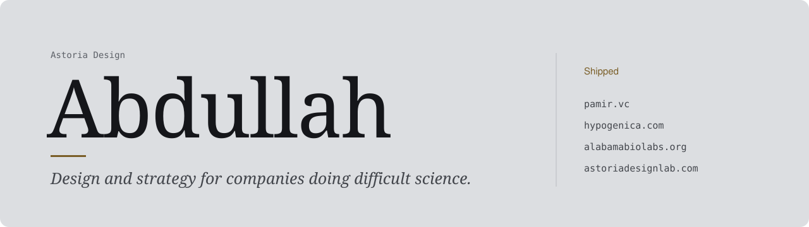
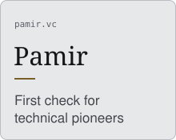
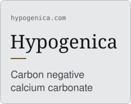
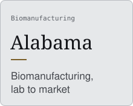
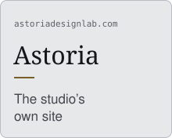

<picture>
  <source media="(prefers-color-scheme: dark)" srcset="assets/banner-dark.svg">
  
</picture>

<picture>
  <source media="(prefers-color-scheme: dark)" srcset="assets/tagline-dark.svg">
  
</picture>

  <a href="https://astoriadesignlab.com"><picture>
    <source media="(prefers-color-scheme: dark)" srcset="assets/button-site-dark.svg">
    
  </picture></a>&nbsp;
  <a href="https://astoriadesignlab.com/#contact"><picture>
    <source media="(prefers-color-scheme: dark)" srcset="assets/button-contact-dark.svg">
    
  </picture></a>

  <picture>
    <source media="(prefers-color-scheme: dark)" srcset="assets/work-pamir-dark.svg">
    
  </picture>
  <picture>
    <source media="(prefers-color-scheme: dark)" srcset="assets/work-hypogenica-dark.svg">
    
  </picture>
  <picture>
    <source media="(prefers-color-scheme: dark)" srcset="assets/work-alabama-dark.svg">
    
  </picture>
  <a href="https://astoriadesignlab.com"><picture>
    <source media="(prefers-color-scheme: dark)" srcset="assets/work-astoria-dark.svg">
    
  </picture></a>

## About

I run [Astoria Design](https://astoriadesignlab.com), a design and strategy studio for deep tech and biotech companies. We build websites, refresh brands and design investor decks for companies whose science is genuinely difficult.

The work goes in front of investors, regulators and clinical partners, so the job is to make the science legible to the people deciding whether to fund it, buy it or join it. Most of what we ship goes out with words we wrote.

## Experience

**Astoria Design**, design and strategy studio

- Websites for science companies, from the visual language to launch on the client's own domain
- Brand work, from positioning to a full refresh of the identity
- Investor decks that turn a round into a narrative, finished to the same standard as the sites

## Projects

**Live**

- **Pamir Ventures**: an illustrated alpine world with a day side and a night side, for a fund that writes the first check for technical pioneers.
- **Hypogenica**: a dark mineral world for a company making carbon negative calcium carbonate with a process inspired by cave science.
- **Alabama Biomanufacturing Labs**: the public home of the program helping Alabama's biomanufacturing companies grow from the lab to the market.
- [**Astoria Design**](https://astoriadesignlab.com): the studio's own site.

**In progress**

- **Avatrial**: a site for a cancer drug discovery company that argues its thesis, from a shedding helix hero to the usual broken process redrawn as one connected loop.
- **Panakeia**: the platform reframed around one promise, one pathology slide in and a full multiomic profile out.
